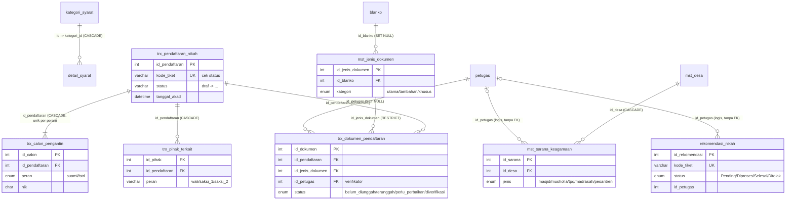

# Progres Proyek RIKUA

Dokumen ini merangkum progres pengerjaan aplikasi Android **RIKUA** (layanan KUA Kec. Randudongkal) selama sesi kerja bersama.

Terakhir diperbarui: 23 November 2026

---

## 1. Ringkasan Proyek

- **Aplikasi**: RIKUA — layanan digital KUA Kecamatan Randudongkal.
- **Tech stack**: Android native, Java + XML, Gradle (build via `build_with_jdk.bat`).
- **Backend konten**: PHP (`rikua_api/` di repo ini) + database MySQL `rikua`, diakses via API lokal `http://192.168.1.6/rikua_api/...`.
- **Backend autentikasi**: PHP terpisah di `RIKUA_auth_backend` (di luar repo ini), basis URL di `ApiConfig.java`: `http://192.168.1.6/RIKUA_auth_backend/` dengan endpoint `auth/google_login.php` dan `auth/admin_login.php`.
- **Identitas desain**: Forest Green + Gold, font serif sebagai suara institusional, latar cream untuk area editorial.

## 2. Fitur / Halaman yang Sudah Dikerjakan

### Dashboard Admin (perubahan lokal, belum ter-commit)
- **Login admin**: `AdminLoginActivity` kini membuka `AdminDashboardActivity` setelah autentikasi berhasil dan membersihkan task agar tombol Back tidak kembali ke login.
- **Dashboard petugas**: halaman baru `activity_admin_dashboard.xml` dan `AdminDashboardActivity` menampilkan data ringkasan, antrean berkas, kuota 7 hari, aksi cepat, tautan SIMKAH, notifikasi, bottom navigation, dan konfirmasi logout.
- **API dashboard**: `ApiConfig.ADMIN_DASHBOARD` mengarah ke `admin_dashboard.php` pada backend autentikasi; permintaan membawa bearer token dan menangani respons, loading, empty, serta error. Uji perangkat terbaru menerima HTTP 200 dari API dengan sesi admin valid.
- **Perbaikan masa berlaku sesi**: parser lama tidak menerima ISO timestamp dengan zona waktu, sehingga format seperti `...Z` atau `...+07:00` dapat salah ditolak. `SessionExpiry` kini menerima epoch detik/milidetik, ISO-8601 UTC/offset, serta datetime tanpa zona yang ditafsirkan sebagai `Asia/Jakarta`; tanggal tidak valid, token kosong, dan masa berlaku kosong/kedaluwarsa ditolak. Login admin hanya menyimpan sesi dengan role `admin`, token/ID, dan `expires_at` valid yang masih akan datang.
- **Routing sesi**: `SplashActivity` mengarahkan role admin ke dashboard admin dan role lain ke beranda pengguna; sesi kedaluwarsa dibersihkan dan kembali ke halaman login sesuai role.
- **Komponen pendukung**: adapter dan model antrean/kuota admin ditambahkan bersama drawable ikon, avatar, menu bottom navigation, manifest activity, dan resource strings/dashboard.
- **Backend autentikasi admin**: source tersedia di `D:\laragon\www\RIKUA_auth_backend` di luar repository. Login menerbitkan token 64 karakter dan menyimpan SHA-256 token di `admin_sessions`. Validator dashboard kini memakai helper bersama, menerima header Authorization dari beberapa jalur PHP, dan mencatat status validasi tanpa token/hash.
- **Perbaikan HTTP 401**: aturan `.htaccess` meneruskan header Authorization ke PHP. Pengujian Android dan log PHP menunjukkan header/Bearer dikenali, sesi ditemukan, tidak dicabut, belum kedaluwarsa, dan admin aktif. Login perangkat berhasil, dashboard terbuka, lalu API membalas HTTP 200. Request tanpa token tetap ditolak dengan HTTP 401.
- **Penanganan respons API**: HTTP 401 tetap membersihkan sesi; HTTP 403 menampilkan pesan akses ditolak tanpa menghapus sesi. Error HTTP 500 dan gangguan jaringan tidak otomatis menghapus sesi.
- **Audit regresi Google Sign-In**: sejak baseline Git `98d4922`, `LoginActivity`, dependensi Credential Manager, Web Client ID Android, serta package `com.example.rikua` tidak berubah. `setFilterByAuthorizedAccounts(false)` sudah digunakan. Web Client ID Android cocok dengan konfigurasi backend. Debug SHA-1 berhasil dihitung, tetapi pendaftarannya di Google Cloud Console tidak dapat diverifikasi dari repository lokal.
- **Credential Manager**: pesan `No credentials available` terjadi sebelum ID Token dikirim ke backend. Tombol Google kini mencoba `GetGoogleIdOption` dengan semua akun; jika menerima `NoCredentialException`, aplikasi mencoba sekali lagi memakai `GetSignInWithGoogleOption`. Pembatalan chooser tidak memicu fallback. Pada uji perangkat setelah perubahan, satu kali tekan dengan akun yang sama berhasil sampai `MainActivity`; backend membalas HTTP 200 dan sesi tercatat. Kegagalan Credential Manager sebelum perubahan bukan akibat perubahan admin yang ditemukan di Git.
- **Perbaikan backend Google**: `auth/google_login.php` memanggil `issue_session()`, tetapi fungsi tersebut tidak tersedia di `auth/common.php`; log PHP mengonfirmasi HTTP 500 karena fungsi tidak ditemukan. Fungsi penerbitan sesi pengguna dipulihkan dengan hash SHA-256 dan masa berlaku 30 hari dalam zona `Asia/Jakarta`.
- **Clock skew Google token**: log juga menunjukkan klaim `iat` beberapa detik lebih maju dari jam backend. Perangkat terukur sekitar 7 detik lebih maju dan layanan sinkronisasi waktu Windows belum berjalan. Sesuai keputusan pengguna, verifikasi JWT diberi toleransi 30 detik; signature, audience, issuer, dan expiry tetap diverifikasi.

### Autentikasi & Logout
- **Splash** (`SplashActivity`): animasi fade, lalu routing berdasarkan sesi valid dan role — admin → Dashboard Admin, user → Beranda, sesi tidak valid → halaman login sesuai role.
- **Login pengguna** (`LoginActivity`): Google Sign-In memakai Credential Manager dan Web Client ID di `ApiConfig`; login email/password masih berupa validasi form dan pesan pending, belum mengirim request backend.
- **Registrasi** (`RegisterActivity`) masih berupa form/validasi dengan pesan pending; belum menyimpan akun atau menghubungi backend. **Login Admin** (`AdminLoginActivity`) memakai akun terdaftar, tanpa Google.
- **Sesi** (`SessionManager`): token + identitas disimpan di SharedPreferences `rikua_auth`; `clearSession()` menghapus seluruhnya.
- **Logout dari Navigation Drawer**: menu hamburger dipisah dari bottom nav — file baru `menu/drawer_menu.xml` (6 item: Beranda, Layanan, Konsultasi, Fasilitas, Formulir, **Keluar** dengan ikon `ic_nav_logout`). `NavigationView` kini memakai `@menu/drawer_menu`, `BottomNavigationView` tetap `@menu/bottom_nav_menu` (5 item). Klik Keluar → dialog konfirmasi ("Keluar dari RIKUA?" / Batal / Keluar) → `clearSession()` → `LoginActivity` dengan `FLAG_ACTIVITY_NEW_TASK | FLAG_ACTIVITY_CLEAR_TASK` + `finish()`, sehingga tombol Back tidak kembali ke dashboard.
- Verifikasi build fitur logout: `:app:assembleDebug --rerun-tasks --no-configuration-cache` → **BUILD SUCCESSFUL** (36/36 task dieksekusi ulang).

### Fitur fungsional (history commit)
- Pendaftaran Nikah 6 langkah, Rekomendasi Nikah, Syarat Nikah (fitur selesai).
- Isbat Nikah, Duplikat Buku Nikah, Jadwal, Pengumuman, Wali Nikah, Taukil, Wakaf (layout + logika diperbarui).
- Facilities / Sarana Keagamaan + Facility Detail (layout, adapter, manifest).
- Blanko N1–N6 (`BlankoActivity`), Cek Status via kode tiket (`CekStatusActivity`).
- Backend PHP `rikua_api` + skema database ditambahkan.
- Animasi transisi antar-activity; network security config (`192.168.1.6`, `192.168.1.15`).

### Redesign UI (workflow Antislop)
Tiga layar utama dirotasi total secara visual sambil mempertahankan **semua ID XML yang di-bind Java**, listener, Intent, panggilan API, dan navigasi:
- **Beranda** (`activity_main.xml`): semua 19 ID Java-bound dipertahankan; ditambah `progress_kuota`, `btn_kuota_retry`, `card_info`; token skala dimens baru; fokus selector `bg_search_input_state.xml`; style `Widget.Rikua.FlatCard`; perbaikan `nav_drawer_header.xml`.
- **Layanan** (`activity_services.xml`, `item_service.xml`): kartu flat hairline, chip filter berwarna custom, header kompak. Catatan: keputusan header putih MaterialToolbar **ditolak user dan sudah di-restore** ke banner hijau RIKUA.
- **Konsultasi** (`activity_consultation.xml`, `item_officer.xml`, `chip_expertise.xml`): pil status `bg_status_pill_available/offline`, tile ikon putih, komposisi internal baru.

Halaman lain yang disentuh setelahnya:
- **Facilities**: strip dekoratif `view_accent_strip` dihapus (beserta pemakaiannya di `FacilityAdapter.java`).
- **Blanko**: penyatuan warna `consult_primary` → `primary_forest`; perbaikan kontras badge Wajib di `BlankoAdapter.java` + `item_blanko.xml`.
- **Facility Detail**: di-refine — hero CollapsingToolbarLayout 320dp, blok identitas editorial, dua tombol aksi sejajar, spec-sheet putih 3 grup, footer strip emas.
- **Rekomendasi Nikah**: hero cream, teks token gelap (kontras lulus AA), watermark dihapus.
- **Isbat Nikah**: arah desain editorial (kertas cream, judul serif, rule emas, timeline hijau solid).
- **Duplikat Buku Nikah**: identitas visual netral sendiri (putih/off-white, aksen champagne).
- **Syarat Nikah**: redesign lewat commit `98d4922` (`activity_syarat_nikah.xml` + drawable `bg_syarat_*`).

## 3. Database yang Digunakan

- **DBMS**: MySQL 8.0 (XAMPP lokal), database **`rikua`**, charset `utf8mb4`, engine InnoDB.
- **Skrip**: `database/01_struktur.sql` (14 tabel + FK) dan `database/02_data_master.sql` (data konten untuk 8 tabel: `blanko`, `kategori_syarat`, `detail_syarat`, `langkah_pendaftaran`, `layanan_kua`, `mst_desa`, `mst_jenis_dokumen`, `mst_sarana_keagamaan`). Data transaksi, `petugas`, dan `rekomendasi_nikah` tidak disertakan di repo.
- **Tabel per aplikasi** (kolom `users`/sesi dikelola backend `RIKUA_auth_backend`, skemanya tidak ada di repo ini):

| Kelompok | Tabel | Digunakan oleh API (rikua_api) |
|---|---|---|
| Transaksi | `trx_pendaftaran_nikah` | `get_kuota.php`, `api_cek_status.php`, `get_pengumuman.php`, `langkah_6_tinjau.php`, `get_langkah_4_wali.php`, `upload_dokumen.php`, `get_calon_pengantin.php` |
| Transaksi | `trx_calon_pengantin` | `get_calon_pengantin.php`, `api_cek_status.php`, `langkah_6_tinjau.php`, `get_pengumuman.php` |
| Transaksi | `trx_pihak_terkait` | `get_langkah_4_wali.php`, `langkah_6_tinjau.php` |
| Transaksi | `trx_dokumen_pendaftaran` | `upload_dokumen.php`, `get_jenis_dokumen.php`, `api_cek_status.php`, `langkah_6_tinjau.php` |
| Master | `mst_desa` | JOIN di `get_sarana.php` |
| Master | `mst_jenis_dokumen` | `get_jenis_dokumen.php`, `upload_dokumen.php` |
| Master | `mst_sarana_keagamaan` | `get_sarana.php` |
| Konten | `layanan_kua` | `get_layanan.php` |
| Konten | `kategori_syarat` / `detail_syarat` / `langkah_pendaftaran` | `get_syarat_nikah.php` |
| Konten | `blanko` | `get_blanko.php` (file PDF di `rikua_api/uploads/blanko/`) |
| Konten | `rekomendasi_nikah` | `get_rekomendasi_nikah.php` (insert pengajuan) |
| Konten | `petugas` | `get_petugas.php` |

### ERD

Relasi fisik = FOREIGN KEY di `01_struktur.sql`; relasi logis = kolom referensi tanpa FK constraint.

## 4. Perbaikan Aksesibilitas (WCAG)

Rasio kontras dihitung dengan skrip antislop-human; enam pasangan gagal diperbaiki hingga lulus AA:
- `text_tertiary` #707976 (gagal di putih) → `text_muted` #5B6663.
- Inisial putih di avatar abu/emas (1.83/~2.4) → token digelapkan.
- Hijau WhatsApp #1DA851 + teks putih (3.10) → `whatsapp_brand_dark` #0E7A44 (5.40), sekaligus memperbaiki `activity_blanko.xml`.
- Teks status "tersedia" di pill mint (3.32) → forest di `forest_container` (7.84).

## 5. Penanganan State (Loading / Empty / Error)

- Ditambahkan di Beranda, Layanan, Konsultasi: spinner + empty view + teks berbeda antara "tidak ada hasil" vs "gagal memuat" (flag `gagalMemuat`).
- `ConsultationActivity`: kini melempar error bila respons API tidak success — memperbaiki bug spinner berputar permanen.

## 6. Aturan Desain yang Disepakati

- **Halaman top-level WAJIB mempertahankan banner hijau RIKUA** di atas (`bg_hero_curved` + `bg_islamic_pattern` + logo + "RIKUA" + "KUA Kec. Randudongkal" + tombol drawer); dilarang diganti MaterialToolbar putih; status bar `primary_forest`, light status bars false.
- **Drawable shared** (`bg_hero_curved`, `bg_islamic_pattern`, `bg_search_field`, dll.) tidak boleh diedit — dibuat varian lokal per layar.
- Copy UI tanpa hardcoded counts (data kini API-driven), tanpa em-dash/buzzword; indikator status harus disertai teks, bukan warna saja.
- Redesign = komposisi struktural baru, bukan ganti warna tipis; hasil harus terlihat modern dan profesional.
- Header drawer, ikon navigasi, dan ID view Java-bound dipertahankan saat menambah menu (kasus `drawer_menu.xml`).

## 7. Verifikasi & Build

- Build: `cmd /c build_with_jdk.bat :app:assembleDebug` → BUILD SUCCESSFUL (terakhir diverifikasi penuh untuk fitur logout, 54s, 36 task).
- Uji unit sesi: `:app:testDebugUnitTest --rerun-tasks --no-configuration-cache` → **BUILD SUCCESSFUL**, 4 tes baru lulus; mencakup epoch detik/milidetik, ISO UTC/offset, datetime Jakarta, serta tanggal kosong/tidak valid dan token kedaluwarsa.
- Build perubahan 23 November 2026: `:app:assembleDebug --rerun-tasks --no-configuration-cache` → **BUILD SUCCESSFUL** (36 task).
- Pemanggilan awal gagal karena Gradle memilih runtime Java VS Code tanpa `jlink.exe`; konfigurasi build diarahkan ke JDK 17 lokal lengkap `C:\Users\sabit\.jdks\jbr-17.0.14` yang memiliki `java.exe` dan `jlink.exe`.
- Lint: `lintDebug` setelah setiap batch edit; temuan pada file yang diubah dibersihkan; `tools:ignore` hanya dengan alasan nyata.
- Baseline lint pre-existing yang **bukan regresi**: 13 error (12 GestureBackNavigation, 1 NewApi `windowLightNavigationBar` di `themes.xml:23`).
- Perubahan resource kecil butuh `--rerun-tasks --no-configuration-cache` agar terbukti benar-benar diproses ulang (plain assembleDebug bisa UP-TO-DATE palsu).
- Artefak log build di root repo sudah dihapus dan di-gitignore (commit `5dfbc93`).
- Verifikasi terbaru 23 November 2026: `cmd /c build_with_jdk.bat :app:testDebugUnitTest :app:assembleDebug --rerun-tasks --no-configuration-cache` → **BUILD SUCCESSFUL** (41 task); PHP lint untuk `auth/common.php` dan `admin_dashboard.php` lulus.
- Uji perangkat 23 November 2026: login admin HTTP 200, token/role/expiry valid, sesi tersimpan dan valid, `AdminDashboardActivity` terbuka, lalu dashboard API merespons HTTP 200. Log PHP aman mengonfirmasi sesi admin aktif dan berlaku; token dan hash tidak dicatat.
- Request dashboard tanpa Authorization tetap merespons HTTP 401. Tampilan data/empty state tidak direkam secara visual.
- Audit dan uji Google Sign-In 23 November 2026: sebelum perbaikan, PHP access/error log menunjukkan HTTP 500 dari `issue_session()` yang hilang dan penolakan `iat` akibat selisih jam. Setelah helper, toleransi 30 detik, dan fallback Credential Manager diterapkan, uji satu-tekan dengan akun yang sama mencapai beranda; access log menunjukkan HTTP 200 dan tabel sesi memiliki sesi pengguna baru.
- `:app:signingReport` berhasil dijalankan untuk memeriksa sertifikat debug. Fingerprint belum dapat dicocokkan dengan OAuth Android Client di Google Cloud Console karena konfigurasi cloud tidak tersedia.

## 8. Status Saat Ini

Cabang `main` berisi commit autentikasi, redesign, dan logout terdahulu. Saat ini working tree **memiliki perubahan yang belum dikomit**, termasuk dashboard admin, pembaruan sesi autentikasi, routing login admin, dan beberapa penyesuaian API/IP serta sumber UI.

Komponen yang sudah ter-push:
- Autentikasi pengguna, Google Sign-In, registrasi, dan logout drawer.
- Redesign beranda, layanan, konsultasi, serta halaman fungsional sebelumnya.
- Commit terakhir yang ter-push: `5dfbc93 chore: hapus file log build dari repo dan abaikan lewat .gitignore`.

### Belum selesai / perlu perhatian
- [ ] Uji logout admin dan pastikan sesi/token dicabut sesuai perilaku backend.
- [ ] Uji token admin yang benar-benar kedaluwarsa atau dicabut; request tanpa token sudah dipastikan ditolak HTTP 401.
- [ ] Verifikasi visual dashboard pada device/emulator untuk data, empty state, loading, error, kuota, antrean, logout, dan bottom navigation.
- [ ] Uji Google Sign-In dengan akun yang belum pernah diotorisasi dan pembatalan chooser; akun sebelumnya sudah berhasil sampai beranda dengan satu kali tekan setelah fallback ditambahkan.
- [ ] Implementasi serta uji login email/password dan registrasi pengguna; keduanya masih placeholder tanpa request backend.
- [ ] Cocokkan fingerprint SHA-1 debug dan konfigurasi OAuth Android Client di Google Cloud Console; konfigurasi tersebut tidak tersedia lokal.
- [ ] Sinkronkan jam Windows dan perangkat Android; toleransi JWT 30 detik saat ini menangani selisih kecil, tetapi layanan waktu Windows tidak berjalan saat audit.
- [ ] Uji ulang login admin dan dashboard setelah perubahan backend Google; alur admin sebelumnya sudah berhasil HTTP 200, dan kode admin tidak diubah pada perbaikan Google ini.
- [ ] Selesaikan aksi dashboard yang saat ini masih placeholder ("Layar pengelolaan segera hadir").
- [ ] Verifikasi device/emulator: rendering, font-scale clipping, dan alur logout nyata (dialog → sesi terhapus → Back mati).
- [ ] API base URL masih IP LAN `192.168.1.6` (hardcoded di belasan file Java + `network_security_config.xml`) — data tidak bisa load di luar jaringan tersebut; pertimbangkan satu `ApiConfig` untuk semua endpoint.
- [ ] `FacilityDetailActivity` memanggil `get_sarana_detail.php` yang **tidak ada** di folder `rikua_api/` (endpoint yatim).
- [ ] Bug typo di `BlankoActivity.java` baris 51: `BASE_FILE_URL = "http:// 192.168.1.6/..."` ada spasi setelah `http://` → unduh/buka file blanko akan gagal.
- [ ] Backend `RIKUA_auth_backend` (termasuk tabel user/admin, `google_login.php`, `admin_login.php`, dan perubahan autentikasi dashboard) berada di luar repo ini dan belum ikut ter-version.
